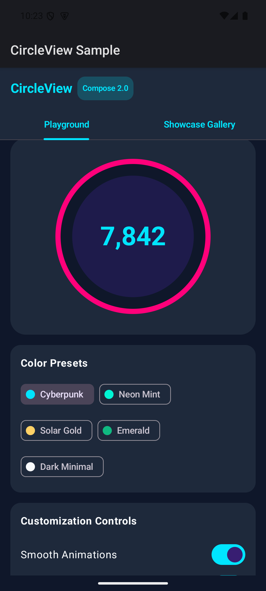

# CircleView Compose 🎨

[](https://developer.android.com/jetpack/compose)
[](https://kotlinlang.org)
[](https://developer.android.com)
[](https://search.maven.org/artifact/io.github.pavlospt/circleview)
[](LICENSE)

A modern, highly customizable **CircleView** component for Android built 100% in **Jetpack Compose** and **Kotlin**. Easily build sleek progress circles, stat badges, dashboard widgets, and interactive circular UI elements.

---

## 📱 Screenshots & Showcase

| Interactive Playground | Color Presets | Showcase Widgets |
|:---:|:---:|:---:|
|  |  |  |

---

## ✨ Features

- ⚡ **100% Pure Jetpack Compose**: Native `@Composable` implementation optimized for performance and smooth re-composition.
- 🎨 **Fully Customizable**: Control stroke width, inner fill radius, background color, stroke color, fill color, text styling, and spacing.
- 💫 **Built-in Smooth Animations**: Parameter changes (colors, sizes, radius) automatically animate with smooth state transitions.
- 📱 **Interactive Sample App**: Explore live sliders, presets (Cyberpunk, Solar Gold, Neon Mint, Emerald), and showcase widgets.
- 🌐 **Maven Central Release**: Official GPG-signed package published directly on Maven Central.

---

## 📦 How to Include in Your Project

### Maven Central Import

Add the dependency directly to your module's `build.gradle.kts`:

```kotlin
dependencies {
    implementation("io.github.pavlospt:circleview:2.0.0")
}
```

---

## 🚀 Quick Start

### Basic Usage in Compose

```kotlin
import androidx.compose.foundation.layout.size
import androidx.compose.runtime.Composable
import androidx.compose.ui.Modifier
import androidx.compose.ui.unit.dp
import androidx.compose.ui.unit.sp
import io.github.pavlospt.circleview.CircleView

@Composable
fun FitnessWidget() {
    CircleView(
        modifier = Modifier.size(200.dp),
        titleText = "8,420",
        subtitleText = "STEPS",
        titleSize = 28.sp,
        subtitleSize = 14.sp
    )
}
```

### Animated CircleView with Custom Colors

```kotlin
import androidx.compose.foundation.layout.size
import androidx.compose.ui.graphics.Color
import androidx.compose.ui.unit.dp
import androidx.compose.ui.unit.sp
import io.github.pavlospt.circleview.CircleView

CircleView(
    modifier = Modifier.size(220.dp),
    titleText = "22.5°C",
    subtitleText = "HEATING",
    titleColor = Color(0xFFFDBA74),
    subtitleColor = Color(0xFFFED7AA),
    strokeColor = Color(0xFFF97316),
    backgroundColor = Color(0xFF451A03),
    fillColor = Color(0xFF7C2D12),
    strokeWidth = 6.dp,
    fillRadius = 0.85f,
    titleSubtitleSpace = 6.dp,
    animated = true // Enables smooth color & geometry transitions when state changes
)
```

---

## 📋 Parameters Reference

| Parameter | Type | Default Value | Description |
|---|---|---|---|
| `titleText` | `String` | `"Title"` | Text displayed in the top row |
| `subtitleText` | `String` | `"Subtitle"` | Text displayed in the bottom row |
| `titleSize` | `TextUnit` | `25.sp` | Font size of the title text |
| `subtitleSize` | `TextUnit` | `20.sp` | Font size of the subtitle text |
| `titleColor` | `Color` | `Color(0xFF00E5FF)` | Color of the title text |
| `subtitleColor` | `Color` | `Color(0xFFFFFFFF)` | Color of the subtitle text |
| `strokeColor` | `Color` | `Color(0xFF00E5FF)` | Color of the outer circle border stroke |
| `backgroundColor` | `Color` | `Color(0xFFFFFFFF)` | Color of background circle between stroke & fill |
| `fillColor` | `Color` | `Color(0xFF333333)` | Color of the inner filled circle |
| `strokeWidth` | `Dp` | `5.dp` | Thickness of outer stroke ring |
| `fillRadius` | `Float` | `0.9f` | Radius ratio of inner circle relative to outer circle (0.0 to 1.0) |
| `titleSubtitleSpace` | `Dp` | `4.dp` | Vertical space separating title and subtitle |
| `showTitle` | `Boolean` | `true` | Visibility toggle for title text |
| `showSubtitle` | `Boolean` | `true` | Visibility toggle for subtitle text |
| `animated` | `Boolean` | `false` | Enables smooth animation on attribute changes |

---

## 🛠️ Publishing Setup (Maven Central)

This repository uses **`com.vanniktech.maven.publish`** to publish signed artifacts (Kotlin sources, Dokka javadoc, and AAR/JAR binaries) directly to **Sonatype Central Portal**.

### 1. Publish to Maven Central

Deploy to Maven Central with your Sonatype credentials:

```bash
./gradlew publishAndReleaseToMavenCentral \
  -PmavenCentralUsername="YOUR_SONATYPE_USER_TOKEN" \
  -PmavenCentralPassword="YOUR_SONATYPE_USER_PASSWORD"
```

### 2. Publish Locally for Testing

```bash
./gradlew publishToMavenLocal
```

---

## 👥 Credits

**Author**: Pavlos-Petros Tournaris ([p.tournaris@gmail.com](mailto:p.tournaris@gmail.com))

- **GitHub**: [@pavlospt](https://github.com/pavlospt)
- **LinkedIn**: [Pavlos-Petros Tournaris](https://www.linkedin.com/in/pavlos-petros-tournaris-44abb218/)

---

## 📄 License

```text
Copyright 2014-2026 Pavlos-Petros Tournaris

Licensed under the Apache License, Version 2.0 (the "License");
you may not use this file except in compliance with the License.
You may obtain a copy of the License at

   http://www.apache.org/licenses/LICENSE-2.0

Unless required by applicable law or agreed to in writing, software
distributed under the License is distributed on an "AS IS" BASIS,
WITHOUT WARRANTIES OR CONDITIONS OF ANY KIND, either express or implied.
See the License for the specific language governing permissions and
limitations under the License.
```
